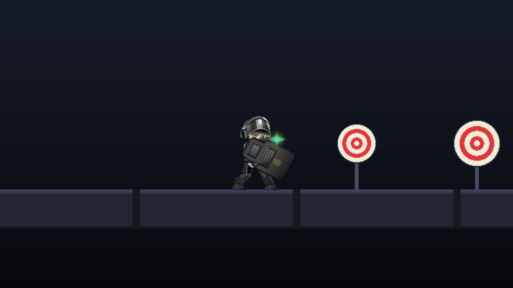
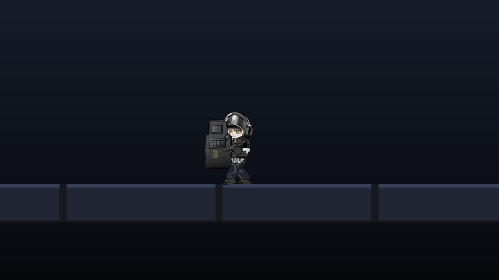
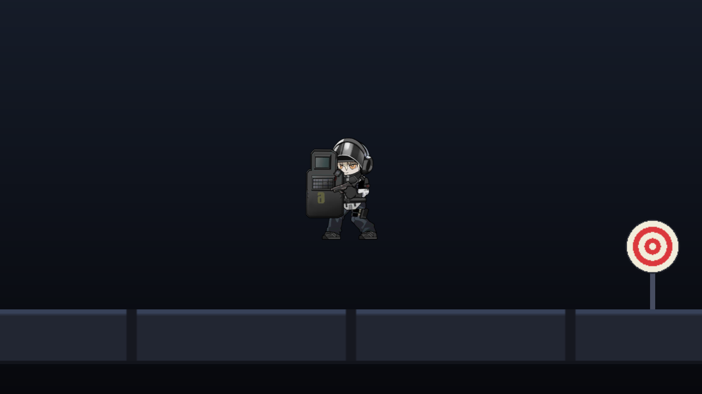
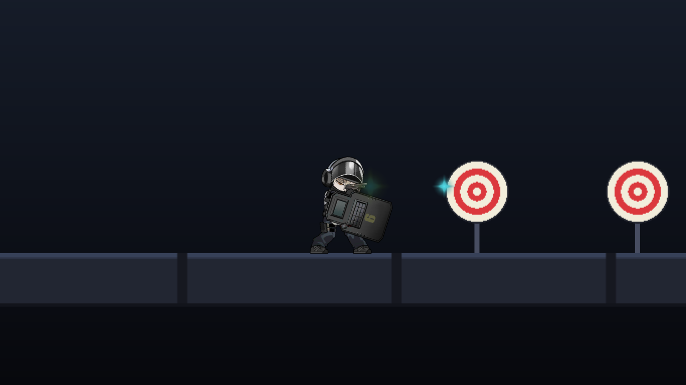

# ZeroWalker Demo — 玩家控制、按住连射、跳跃、冲刺与近战（Blitz / Spine）

> 本文件记录当前 Demo 中「玩家角色控制 + 状态机动画 + 按住连射 + 跳跃 + 冲刺 + 近战」的实现方式，方便后续继续扩展关卡与敌人。



## 一、操作方式

| 输入 | 行为 |
| --- | --- |
| `A` / `D` | 向左 / 向右移动（同时自动转身；空中也可以操控） |
| `空格` | 跳跃（使用 `Idle` 动画代替跳跃动画） |
| `左 Shift` | 向前冲刺一段距离（1 秒冷却，冲刺期间锁定输入） |
| `F` | 近战攻击：播放 `Skill_02` 动画，期间原地不动 |
| 鼠标左键（按下） | 进入攻击：播放 `Attack_Begin`，随后进入 `Attack_Loop` |
| 鼠标左键（按住） | 保持 `Attack_Loop`，每个 `OnAttack` 事件射出一发（约 1.2 秒一发，不是无间隔连发），角色原地不动 |
| 鼠标左键（松开） | 收枪，回到 Idle / Move |

> 子弹不是由计时器生成的，而是由 Spine 动画 `Attack_Loop` 中的 `OnAttack` 事件射出；
> 每次事件射出的子弹都使用特殊颜色/弹体外观，和普通子弹区分（见第五节）。

## 二、场景结构（SampleScene）

```
SampleScene
├─ Main Camera
│   ├─ Camera           正交投影，Size 3.6
│   ├─ CameraFollow2D   平滑跟随玩家（可勾选 lockY 锁定高度）
│   └─ Background       渐变背景（相机子物体，跟随视野）
├─ Player               Tag = Player，Rigidbody2D + CapsuleCollider2D
│   ├─ Visual           Blitz 角色：SkeletonAnimation + SpineAnimationPlayer
│   └─ MuzzleFlash      枪口火光：SpriteRenderer + SpriteFlash
├─ Ground               地面 200 × 1，BoxCollider2D
└─ Targets              3 个标靶：ShootableTarget + BoxCollider2D（触发器）
```

> `Visual` 的 `localScale.x` 取 ±1 实现左右翻转，物理碰撞体不受影响。
> 相机拉远后角色约占画面高度的 19%，比之前的 24% 更小，能同时看到更多场景与标靶。

## 三、有限状态机

状态机实现在 `Assets/Scripts/Player/States/`，每个状态自己决定何时切换，控制器只负责驱动。

```
          ┌──────────── 松开扳机（Attack_End 播完）────────────┐
          ▼                                                    │
      ┌────────┐   A/D   ┌────────┐   左键按下   ┌──────────┐  │
      │  Idle  │ ──────▶ │  Move  │ ───────────▶ │  Attack  │──┘
      │        │ ◀────── │        │              │          │
      └────────┘  停键    └────────┘              └──────────┘
          ▲                                            │ ▲
          └──────────── 松开扳机（Attack_End 播完）───────┘ │
                                     左键按下（收枪中可打断）┘

跳跃/冲刺分支（Idle / Move）：
  Idle / Move ──空格──▶ Jump（播放 Idle 动画）──落地──▶ Idle / Move
  Idle / Move ──左 Shift（冷却结束）──▶ Dash（播放 Move 动画）──约 0.2s──▶ Idle / Move

近战分支（Idle / Move）：
  Idle / Move ──F──▶ Melee（播放 Skill_02）──动画结束（约 1s）──▶ Idle / Move
```

### 各状态行为

| 状态 | 播放动画 | 行为 |
| --- | --- | --- |
| `PlayerIdleState` | `Idle`（循环） | 水平速度归零；检测 A/D、空格、左 Shift、F 与左键 |
| `PlayerMoveState` | `Move`（循环） | 按 `moveSpeed` 移动并转身；可起跳/冲刺/近战 |
| `PlayerJumpState` | `Idle`（循环，代替跳跃动画） | 起跳初速度由 `jumpForce` 决定；空中保留水平操控，落地后回到 Idle / Move；空中不响应射击 |
| `PlayerDashState` | `Move`（循环，代替冲刺动画） | 朝当前朝向前进约 4 米（`dashDistance`）；期间锁定方向与输入；结束后回到 Idle / Move；1 秒冷却内不能再次冲刺 |
| `PlayerMeleeState` | `Skill_02`（单次） | 按 F 进入；播放完整的约 1 秒近战动画，期间原地不动、朝向锁定，不响应移动/跳跃/冲刺/射击 |
| `PlayerAttackState` | `Attack_Begin` → `Attack_Loop`（循环）→ 松开后 `Attack_End` | 按住时每个 `OnAttack` 事件出一发，射速由动画循环决定；射击期间水平速度强制为 0，只允许原地转身 |

### 攻击时序

1. 左键按下 → 播放 `Attack_Begin`（抬枪），并排队 `Attack_Loop`（循环）。
2. 进入 `Attack_Loop` 后，Spine 事件 `OnAttack`（时间点 0.0333s）触发 → 从 `F_Muzzle` 骨骼位置射出一发**特殊子弹**。
3. 继续按住：`Attack_Loop` 正常循环，每循环一次都会再次触发 `OnAttack` 并出一发。
   因此射速由动画循环时长决定（约 1.2 秒一发），不是按帧或无间隔开火。
4. 松开左键：如果本状态已经出过弹 → 播放 `Attack_End` 收枪，结束后回到 `Idle`/`Move`。
   若松开时还没出弹（极短点击），会等第一次 `OnAttack` 出弹后再收枪，保证“点一下必定打出一发”。
5. 收枪过程中再次按下左键 → 立即重新进入攻击，保证连点手感。

### 跳跃时序

1. `Idle` / `Move` 下按空格，且 `PlayerController.IsGrounded` 为 true → 切换到 `PlayerJumpState`。
2. 进入跳跃状态立即播放 `Idle` 动画，并给 `Rigidbody2D.velocity.y` 赋 `jumpForce`（默认 9）。
3. 垂直方向由 `Rigidbody2D` 的重力（`Gravity Scale = 3`）控制；空中仍可用 A/D 水平移动/转身。
4. 脚底落地检测通过（`IsGrounded`）且垂直速度不再向上，按当前移动输入回到 `Idle` 或 `Move`。
5. 跳跃是边沿触发：按住空格不会连跳，也没有二段跳。

### 冲刺时序

1. `Idle` / `Move` 下按左 Shift，且 `PlayerController.CanDash` 为 true → 切换到 `PlayerDashState`。
2. 进入状态立即播放 `Move` 动画（没有专用冲刺动画），并在 `BeginDash()` 中启动 1 秒冷却。
3. 冲刺期间水平速度固定为 `dashDistance / dashDuration`（默认 4 / 0.2 = 20 m/s），朝当前朝向移动；
   期间不响应 A/D、空格与射击，方向也不会改变。
4. 持续 `dashDuration`（默认 0.2s）后停止，按当前移动输入回到 `Idle` 或 `Move`。
5. 冷却从冲刺开始时计时 1 秒；冷却未结束时按左 Shift 不会进入冲刺，长按也不会自动再次冲刺。

### 近战时序

1. `Idle` / `Move` 下按 F → 切换到 `PlayerMeleeState`。
2. 进入状态立即停止水平移动，并播放 Spine 的 `Skill_02` 动画（单次，约 1.0 秒）。
3. 动画期间角色原地不动、朝向锁定；移动、跳跃、冲刺和射击输入都被忽略。
4. 动画播放完毕后，按当前移动输入回到 `Idle` 或 `Move`。
5. F 是边沿触发，按住不会连续近战；动画时长即当前的近战硬直/冷却，没有额外的冷却参数。

## 四、脚本清单

| 文件 | 职责 |
| --- | --- |
| `Player/PlayerController.cs` | 输入 → 状态机 → 动画 → 移动/转向/跳跃/冲刺/近战/开火的总控；提供 `IsGrounded`、`Jump()`、`CanDash`、`BeginDash()`、`ShotCount` 等运行数据 |
| `Player/PlayerInputReader.cs` | 读取 A/D、空格、左 Shift、F 与鼠标左键（含按下/按住两种状态）；内置「调试输入覆盖」 |
| `Player/SpineAnimationPlayer.cs` | 对 `Spine.AnimationState` 的薄封装：`Play` / `Queue` / 查时长，并转发 `SpineEvent` 动画事件 |
| `Player/PlayerAnimations.cs` | 动画名与动画事件名常量（含 `Skill_02`） |
| `Player/MuzzlePoint.cs` | 读取 Spine 骨骼 `F_Muzzle` 的世界坐标；播放（可着色的）枪口火光 |
| `Player/States/IState.cs` | 状态接口（Enter / Tick / FixedTick / Exit） |
| `Player/States/StateMachine.cs` | 通用状态机（切换去重、生命周期转发） |
| `Player/States/PlayerState.cs` | 玩家状态基类 |
| `Player/States/PlayerIdleState.cs` | 待机，并响应起跳/冲刺/近战/射击 |
| `Player/States/PlayerMoveState.cs` | 移动，并响应起跳/冲刺/近战/射击 |
| `Player/States/PlayerJumpState.cs` | 跳跃；使用 Idle 动画，处理空中操控与落地 |
| `Player/States/PlayerDashState.cs` | 冲刺；朝当前朝向前进固定距离，处理冲刺结束与状态切换 |
| `Player/States/PlayerMeleeState.cs` | 近战攻击；播放 Skill_02，处理硬直与状态切换 |
| `Player/States/PlayerAttackState.cs` | 按住连射攻击/射击；每次 `Attack_Loop` 的 `OnAttack` 事件出一发 |
| `Combat/Bullet.cs` | 子弹飞行、命中判定、生命周期；普通/特殊两套外观 |
| `Combat/ShootableTarget.cs` | 可被击中的标靶（受击闪白、血量、可选复活） |
| `Camera/CameraFollow2D.cs` | 2D 相机平滑跟随 |
| `VFX/SpriteFlash.cs` | 通用一次性精灵闪光（支持乘色，用于枪口火光和击中特效） |
| `VFX/HitEffect.cs` | 击中特效：接收子弹颜色（`SetTint`），播放闪光，视觉结束后销毁自身实例 |

## 五、子弹与枪口

- 子弹预制体：`Assets/Prefabs/Bullet.prefab`（`Rigidbody2D` + `CircleCollider2D(Trigger)` + `Bullet`）。
- 发射时 `PlayerController.FireSpecial()` 取出 `MuzzlePoint.WorldPosition`（= Spine 骨骼 `F_Muzzle` 的世界坐标）
  作为出生点，方向为角色当前朝向，速度为 `Bullet.speed`。
- 外观：
  - 普通子弹：`normalColor`（默认白色，保持 `Bullet.png` 原本的橙色）。
  - 特殊子弹（`OnAttack` 事件射出）：把弹体换成白色的 `Bullet_Energy.png`（由 `Bullet.png` 的亮度提取生成），
    再乘 `specialColor`（默认青蓝色），并放大 `specialScale` 倍；枪口火光也会同步染成同样的颜色。
  - 两张图都走同一个 `SpriteRenderer`，因此不会额外增加发射物数量。
- 子弹采用连续碰撞检测，命中标靶调用 `ShootableTarget.TakeDamage()`，随后自身销毁；
  对玩家自身（`PlayerController`）的碰撞会被忽略。
- 命中特效：`Assets/Prefabs/HitEffect.prefab`（`SpriteRenderer` + `SpriteFlash` + `HitEffect`），
  由 `Bullet` 的 `hitEffectPrefab` 字段引用。子弹命中 `ShootableTarget` 时，
  在 `Collider2D.ClosestPoint` 得到的命中点实例化一份；生成时 `Bullet` 会把自身的 `ShotColor` 传给
  `HitEffect.SetTint()`，让特效颜色和射出的子弹保持一致（普通弹白色、特殊弹青蓝色）。
  弹体图使用白色的 `HitSpark_Energy.png`（由 `MuzzleFlash.png` 亮度提取），染色后颜色干净；
  `SpriteFlash` 在 0.15 秒内放大并淡出，`HitEffect` 在视觉结束后（额外 0.02 秒）销毁该实例。
  打在非目标的碰撞体（例如地面）上不会生成特效。
- 若骨骼缺失，`MuzzlePoint` 会退化为 `fallbackLocalOffset`。

## 六、可调参数

| 位置 | 参数 | 默认值 | 说明 |
| --- | --- | --- | --- |
| `Player` → `PlayerController` | `moveSpeed` | 5 | 移动速度 |
| | `jumpForce` | 9 | 起跳初速度（米/秒） |
| | `groundCheckRadius` | 0.12 | 脚底落地检测半径 |
| | `dashDistance` | 4 | 一次冲刺前进的距离（米） |
| | `dashDuration` | 0.2 | 一次冲刺的持续时间（秒） |
| | `dashCooldown` | 1 | 冲刺冷却（秒，从冲刺开始计时） |
| `Player` → `Rigidbody2D` | `Gravity Scale` | 3 | 跳跃下落重力 |
| `Bullet.prefab` | `speed` | 22 | 子弹速度 |
| | `lifeTime` | 2 | 存活时间（秒） |
| | `damage` | 1 | 伤害 |
| | `normalColor` | 白 | 普通子弹着色 |
| | `specialColor` | 青蓝 | 特殊子弹着色 |
| | `specialSprite` | `Bullet_Energy.png` | 特殊子弹的白色弹体贴图 |
| | `specialScale` | 1.2 | 特殊子弹尺寸倍率 |
| | `hitEffectPrefab` | `HitEffect.prefab` | 命中目标时生成的特效 |
| `HitEffect.prefab` | `SpriteFlash.duration` | 0.15 | 闪光持续时间（秒） |
| | `SpriteFlash.startScale` / `endScale` | 0.7 / 1.5 | 闪光缩放范围 |
| | `SpriteRenderer.sprite` | `HitSpark_Energy.png` | 白色火花贴图，运行时染色 |
| | `HitEffect.tint` | 青蓝（由子弹覆盖） | 特效着色；生成时用子弹的 `ShotColor` 覆盖 |
| | `HitEffect.destroyDelay` | 0.02 | 视觉结束后的销毁延迟（秒） |
| `Target_*` | `maxHealth` | 3 | 标靶血量 |
| `Main Camera` | Orthographic Size | 3.6 | 视野大小（值越大角色在画面中越小） |

## 七、运行效果

| 射击（青色为 OnAttack 特殊子弹） | 向左移动 |
| --- | --- |
|  |  |

| 跳跃（使用 Idle 动画） |
| --- |
|  |

| 击中特效（子弹命中标靶的火花） |
| --- |
|  |

## 八、已知限制 / 后续可做

- 出弹完全由 `Attack_Loop` 的 `OnAttack` 动画事件驱动；如果动画里删掉该事件，攻击不会出弹（不会退回定时器逻辑）。
  射速等于动画循环时长（当前约 1.2 秒一发），没有独立的 `fireInterval` 参数，需要改射速时请调整动画循环或事件间隔。
- 跳跃暂用 `Idle` 动画代替，且没有二段跳；空中不响应射击输入（避免空中攻击状态与落地逻辑冲突）。
- 冲刺暂用 `Move` 动画代替，且只能在 `Idle` / `Move` 下发动，空中不可冲刺；冲刺期间不响应移动、跳跃和射击。
  实际位移约为 3.7～4.2 米（取决于物理帧与帧率），冷却从冲刺开始计时 1 秒。
- 近战目前只播放 `Skill_02` 动画（约 1 秒），没有近战判定/伤害/独立冷却；动画期间不能移动或取消，
  且只能从 `Idle` / `Move` 进入（攻击、跳跃、冲刺中不响应 F）。
- 击中特效只在命中 `ShootableTarget` 时生成；打在非目标碰撞体（如地面）上不会生成。
- 暂无受击、死亡状态（`Die`、`Skill_01` 动画资源已就绪，可直接新增状态复用）。
- 输入使用旧版 Input Manager（`Project Settings > Player > Active Input Handling`）。
  若要切到 Input System，只需替换 `PlayerInputReader` 的内部实现。
- 子弹目前为直线飞行、无枪口后坐力，可按需在 `PlayerAttackState` 中叠加相机震动。
- 项目色彩空间为 **Gamma**（2D + Spine 预乘 Alpha 纹理的标准配置）。
